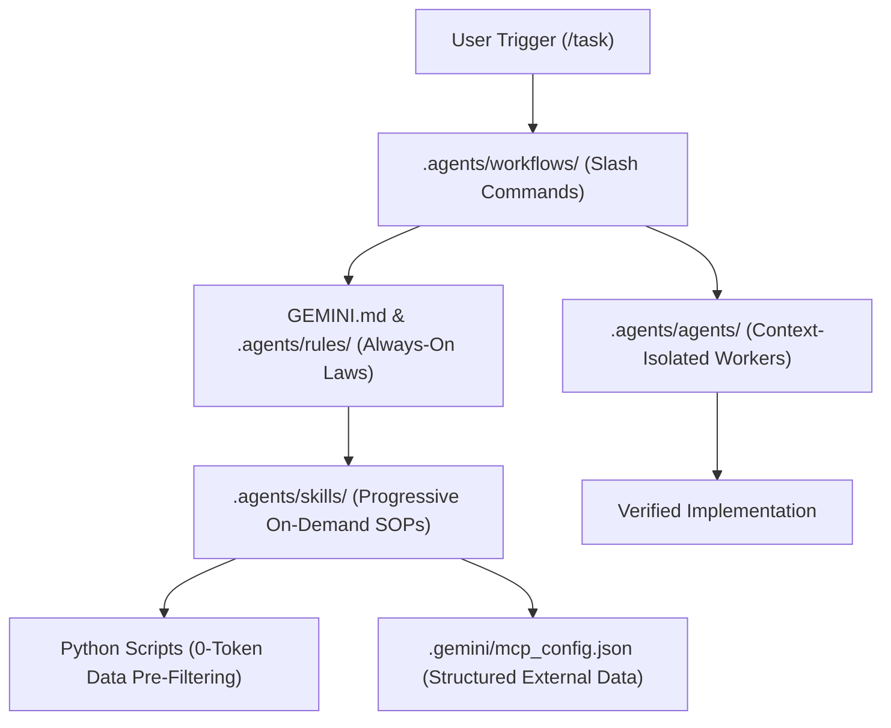

# Antigravity Agentic Starter Template

A clean, production-ready architectural template designed specifically for **Google Antigravity** and modern agentic AI development. 

This repository provides the minimal, unbloated boilerplate required to configure custom **Rules**, **Workflows**, **Skills**, **Subagents**, **MCP connections**, and **Deterministic Python Helpers** for your project.

---

## Architecture Overview



---

## Directory Structure

```text
.
├── GEMINI.md                                  # 1. ALWAYS-ON RULES (Root guardrails & tech stack)
├── .gitignore                                 # Git ignore rules for node, python, & agent temp files
├── README.md                                  # This documentation
│
├── .gemini/
│   └── mcp_config.json                        # 2. MCP CONFIG (External databases, APIs, GitHub)
│
├── scripts/                                   # 3. GLOBAL DETERMINISTIC UTILITIES
│   └── health_check.py                        #    Fast repository sanity check (0-token cost)
│
└── .agents/
    ├── rules/                                 # 4. MODULAR RULES
    │   └── coding-standards.md                #    Domain-specific coding & architectural standards
    │
    ├── workflows/                             # 5. WORKFLOWS (User-Invoked Slash Commands)
    │   ├── task.md                            #    `/task`       -> Standard plan-build-verify cycle
    │   └── checkpoint.md                      #    `/checkpoint` -> Context rotation & handoff save
    │
    ├── skills/                                # 6. AGENT SKILLS (On-Demand Runbooks & Recipes)
    │   └── sample-skill/
    │       ├── SKILL.md                       #    Procedure definition with YAML frontmatter
    │       └── scripts/
    │           └── helper.py                  #    Executable helper script bundled with skill
    │
    └── agents/                                # 7. CUSTOM SUBAGENTS (Isolated Specialists)
        └── sample-agent.md                    #    Dedicated worker role definition
```

---

## The 5 Core Concepts Explained

| Component | Location | Lifecycle | Purpose |
| :--- | :--- | :--- | :--- |
| **Rules** | `GEMINI.md`, `.agents/rules/` | **Always Active** | The non-negotiable boundaries, coding standards, and forbidden actions. |
| **Workflows** | `.agents/workflows/<name>.md` | **Slash Commands (`/<name>`)** | High-level execution pipelines that automate multi-step tasks. |
| **Skills** | `.agents/skills/<name>/SKILL.md` | **Progressive (On-Demand)** | Modular SOPs and recipes loaded only when their `description` matches the task. |
| **Subagents** | `.agents/agents/<name>.md` | **Spawned by Agent** | Isolated worker threads running specialized roles (`flash` or `pro` model). |
| **MCP** | `.gemini/mcp_config.json` | **Tool Integration** | Clean, structured JSON connections to live databases, GitHub, or remote APIs. |

---

## Built-In Token Optimization

This template is configured out of the box to prevent context bloat and minimize token spend:

1. **Progressive Disclosure**: Detailed skill instructions live inside `SKILL.md` files and are never loaded until explicitly needed.
2. **Deterministic Python Helpers**: Heavy tasks (counting rows, checking file trees, formatting data) run on your local CPU via Python scripts rather than burning model tokens.
3. **Targeted Diffs**: Rules in `GEMINI.md` mandate `replace_file_content` rather than generating entire files.

---

## 🔄 Maintaining Fresh Context (Preventing Context Rot)

In long multi-turn conversations (15+ turns), models suffer from **Context Rot**:
- High cost and latency (re-sending 30,000+ tokens on every message).
- Attention degradation and hallucinations ("Lost in the Middle").

This template applies the **RAM vs. Hard Drive** rule:
> **Chat history is volatile RAM.**  
> **Project files on disk are the durable Hard Drive.**

### The 3 Core Strategies Included in This Template

#### 1. The Context Rotation Pattern (`/checkpoint`)
Whenever a conversation approaches 15–20 turns or feels slow:
1. Type `/checkpoint` in chat.
2. The agent automatically inspects git changes and writes a structured status report to `progress.md` (what was done, blockers, and next tasks).
3. **Close the conversation and open a brand new chat tab.**
4. In the new tab, simply say:
   ```text
   Read progress.md and continue with the next task.
   ```
*You get a 100% fresh, fast context window with zero token bloat and zero memory loss.*

#### 2. Subagents as "Context Firewalls"
Noisy trial-and-error work (e.g., debugging a test 6 times, lint fixing) should never happen in your main conversation. 
- Delegate those loops to subagents defined in `.agents/agents/`.
- The subagent absorbs the noisy debug messages in its own isolated thread and reports back a clean 2-sentence summary.
- Your primary chat history stays pristine.

#### 3. Phase-Based Micro-Sessions
Break large features into separate conversational phases:
- **Session 1 (Spec & Architecture)**: Plan the work and write `PLAN.md`.
- **Session 2 (Implementation)**: *(Fresh chat)* Read `PLAN.md` and implement the code.
- **Session 3 (Verification & Polish)**: *(Fresh chat)* Run tests, audit diffs, and finalize.

---

## Quickstart

### 1. Initialize in Your Workspace
Clone or copy this directory into your project root:
```bash
git clone <your-repo-url> my-project
cd my-project
```

### 2. Verify Template Integrity
Run the built-in health check script:
```bash
python scripts/health_check.py
```

### 3. Customize for Your Stack
- Edit `GEMINI.md` to specify your preferred language, framework, and package manager.
- Add your database or GitHub tokens to `.gemini/mcp_config.json` (if using MCP).
- Open the project in **Antigravity**, start a new chat, and try:
  ```text
  /task "Build initial project setup"
  /checkpoint
  ```
